# Corne ZMK Firmware

## Layers

## Timewless home row mod

I'm copying the implementation of timeless homerow mods from https://github.com/urob/zmk-config/tree/main?tab=readme-ov-file#timeless-homerow-mods

## Status service (BLE GATT)

The repo root is also a Zephyr module (`zephyr/module.yml`, `CMakeLists.txt`,
`Kconfig`, `src/zmk_status_gatt.c`). It adds a vendor GATT service that sends
keyboard status to the host, which the Omarchy bar plugin reads through BlueZ.
It is built only into the left half (split central, `CONFIG_ZMK_STATUS_GATT`
depends on `ZMK_SPLIT_ROLE_CENTRAL && ZMK_BLE`). USB is not covered.

| UUID                                   | What        | Access                        |
| -------------------------------------- | ----------- | ----------------------------- |
| `7a6f0001-2c1e-4b8a-9d33-5e4c0f1a9b20` | Service     |                               |
| `7a6f0002-2c1e-4b8a-9d33-5e4c0f1a9b20` | Status      | read (encrypted), notify      |
| `7a6f0003-2c1e-4b8a-9d33-5e4c0f1a9b20` | Firmware    | read, UTF-8 string ≤ 32 bytes |

Status payload, 10 bytes, little-endian:

| Byte | Field                                                                     |
| ---- | ------------------------------------------------------------------------- |
| 0    | Protocol version, `1`                                                     |
| 1    | Highest active layer index                                                |
| 2-5  | `uint32` bitmask of active layers (bit _i_ = layer index _i_)             |
| 6    | Active BLE profile index (0-4)                                            |
| 7    | Flags: bit0 right half connected, bit1 caps word active, bit2 caps word tracking supported |
| 8    | Left (central) battery %, `0xFF` = unknown                                |
| 9    | Right (peripheral) battery %, `0xFF` = unknown or right half disconnected |

Notifications are sent when the layer state, BLE profile, split link or either
battery level changes. Changes within 50 ms
(`CONFIG_ZMK_STATUS_GATT_NOTIFY_DELAY_MS`) go out as one notification, and a
notification is skipped when the payload is unchanged. Subscribing triggers an
immediate notification with the current state.

ZMK v0.3.0 has no caps word event, so flags bit1 and bit2 are always 0 for now.
The right half's link state comes from Zephyr's connection callbacks, because
ZMK raises `zmk_split_peripheral_status_changed` only on the peripheral.

The firmware characteristic holds this repo's short git SHA, with `-dirty` when
the work tree has uncommitted changes, captured when CMake configures the build
(`unknown` without git).

### Battery proxy

`config/corne.conf` enables `CONFIG_ZMK_SPLIT_BLE_CENTRAL_BATTERY_LEVEL_FETCHING`
and `CONFIG_ZMK_SPLIT_BLE_CENTRAL_BATTERY_LEVEL_PROXY`. The left half fetches the
right half's battery level and exposes it to the host as a second Battery Level
characteristic (`0x2A19`, described as "Peripheral 0"), next to its own. The
status payload reports both levels too.

### Local build

`docker compose up` runs `./build.sh`, which passes
`-DZMK_EXTRA_MODULES=/zmk-config` so the module is included. GitHub Actions
picks it up on its own: ZMK's reusable workflow adds the repo as an extra module
when `zephyr/module.yml` exists. Firmware lands in `output/`.

## What am I looking at?

This is the [ZMK](https://zmk.dev/docs) firmware
for the Corne family of split ergonomic keyboards.

It contains keymap definition files for the board in [./config](./config):

Pushing changes will build all the keyboards. You need to be signed in to a GitHub account to push changes and build the firmware.

To build the firmware:

- Fork this repo on GitHub
- Clone your fork locally
- Trigger a build:
  - Make a trivial change to ./build.yaml (or any non \*.md file)
  - Push that change
- Look in the [Actions](https://github.com/filipechagas/zmk-config-corne/actions) tab
  for the build triggered by that change.
- Wait for the build to finish
- Click on the build link next to the green checkbox
- Download the artifact file with the firmware
- See [Installing The Firmware](https://zmk.dev/docs/user-setup#installing-the-firmware)
  for more details from there.

_Once_ your board works with the default firmware,
you can modify the keymap.

- [./config/corne.keymap](./config/corne.keymap)

Modify as needed. Pushing the change will trigger a build as above.

If you want to enable features, modify ./config/corne.conf file.
